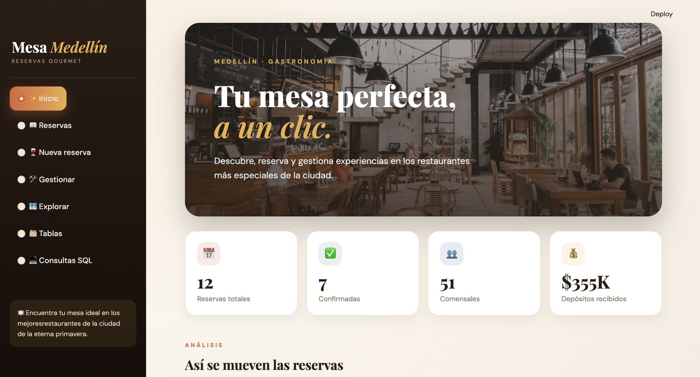
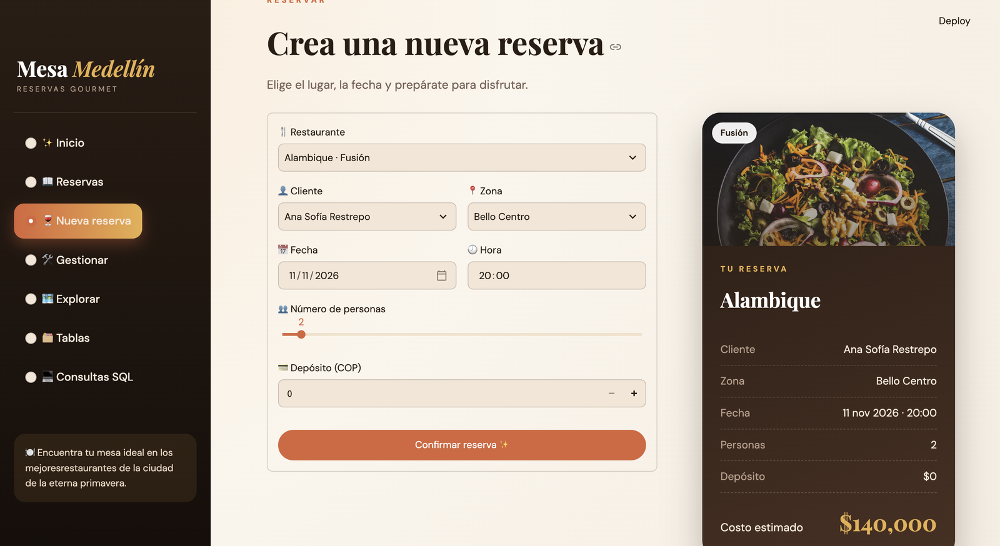
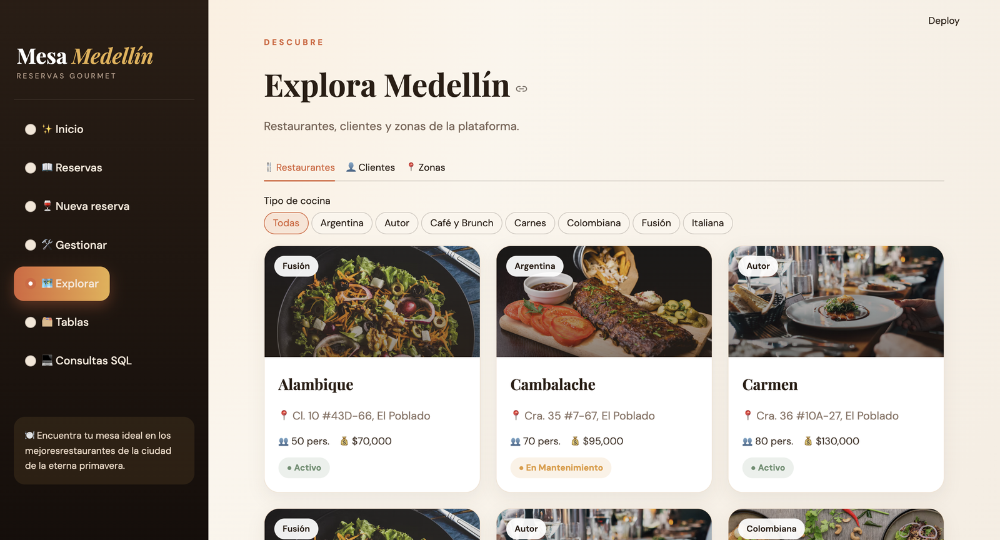
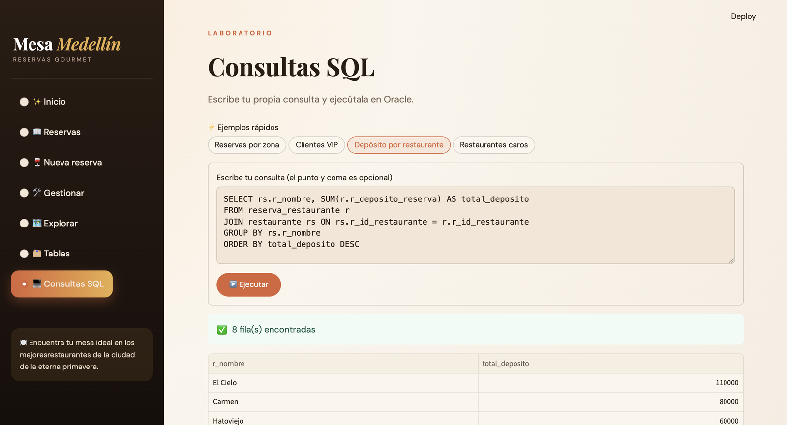

# Mesa Medellín 🍽️

Aplicación web de reservas de restaurantes en Medellín.
Hecha con Oracle SQL, Python y Streamlit.

## Capturas de pantalla

### Inicio
Panel con las cifras principales (reservas totales, confirmadas, comensales y depósitos) y gráficas interactivas.



### Nueva reserva
Formulario para crear una reserva, con un ticket que se actualiza en vivo y calcula el costo estimado.



### Explorar
Catálogo de restaurantes, con filtro por tipo de cocina, además de los clientes y las zonas de Medellín.



### Consultas SQL
Laboratorio para escribir consultas SQL propias y ejecutarlas directamente en Oracle.



## Base de datos
Los scripts están en la carpeta `sql/`:
1. `DDL_PROYECTO_FINAL.sql` crea las tablas (`usuario`, `restaurante`, `zona_medellin`, `reserva_restaurante`).
2. `DML_PROYECTO_FINAL.sql` inserta los datos de ejemplo.

## Cómo ejecutarla
1. Instala las librerías: `pip install -r requirements.txt`
2. Crea el archivo `.streamlit/secrets.toml` con tus credenciales de Oracle (no se sube a GitHub):

```toml
[oracle]
user = "TU_USUARIO"
password = "TU_CONTRASEÑA"
dsn = "TU_SERVICIO_low"
wallet_dir = "/ruta/a/tu/wallet"
wallet_password = "TU_WALLET_PASSWORD"
```

3. Ejecuta: `streamlit run app.py`

## Secciones de la app
Inicio, Reservas, Nueva reserva, Gestionar, Explorar, Tablas y Consultas SQL.
